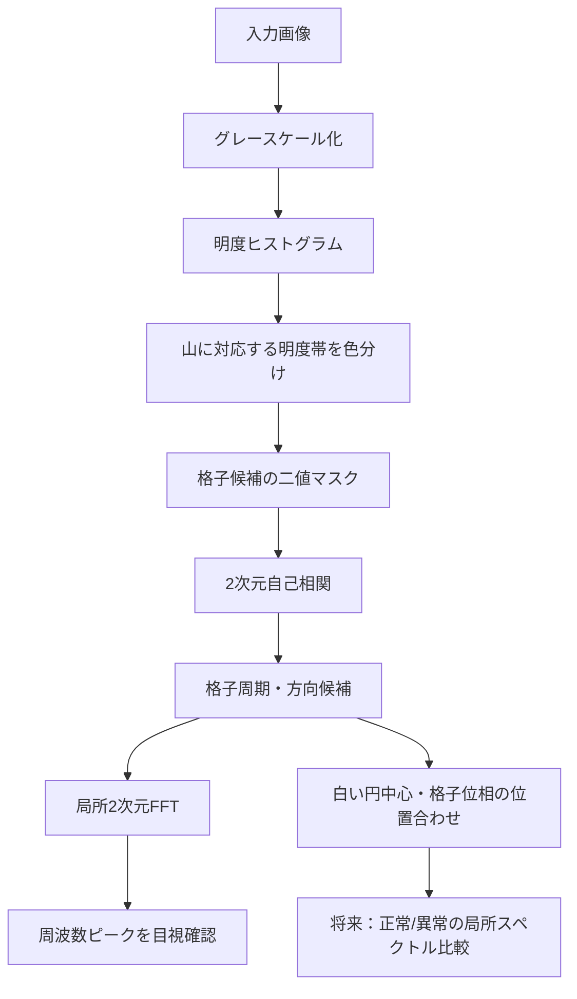

# 外観検査画像解析：解析手順と現在地

> **追記（2026-10-07）：自己相関方向の選び方を比較**  
> 自己相関の局所ピーク列挙に加え、角度方向の帯スコアと正負方向の対称ラジアルピークからベクトルを選ぶ方式を追加しました。image15では旧方式の `(-7,64),(122,16)` に対し、新方式は `(107.1,142.2),(-133.6,116.1)`（長さ約178 px、約86°）を選択。image10では旧方式 `(86,97),(-102,89)` と新方式 `(-106.5,86.2),(90.3,100.3)` が概ね一致しました。位相スコアはimage15で0.109→0.428、image10で0.206→0.731です。confidenceはそれぞれ0.653、0.620で、両方とも `needs_review` です。図と方法の説明は[⑫ 自己相関方向追跡](outputs/⑫_自己相関方向追跡/README.md)を参照してください。

> 旧方式を置き換えず、両者を比較できるようにしています。image15では新方式が約178 pxのベクトルを選び、以前の未トリミングROIの推定値と整合しました。旧方式との差は、自己相関ピークの選び方が周期ベクトル誤選択の一因だった可能性を示します。原点・チェッカー位相スコアは別に最適化しているため、ベクトル選択と位相フィットの影響を分けて確認します。

> **最新状況（2026-10-07）**  
> この資料の後半には、2026-10-06時点の記述が残っています。以下の追記が現在の進捗を示し、古い「スペクトル比較は未検証」という記述を更新します。  
> image15の黒いC字状模様を含む領域171（70×89 px）と、周囲の正常に見える候補8領域を同じサイズ・平均値除去・Hann窓で切り出し、FFTスペクトルを比較しました。対象領域は周辺候補に対し低〜中周波パワーの比率が高く、高周波比率が低い結果でした。一方で、ピーク周波数とピーク高さは周辺候補の範囲内でした。これは**この比較条件でスペクトル差が観察された**ことを示しますが、黒い模様自体が差を生んだ可能性があり、傷が原因とは確定していません。正常・異常の正解ラベルも未確認です。

比較結果（画像・数値）：

- [領域選択と切り出し位置](outputs/⑪_FFT正常候補比較/image15/01_region_selection.png)
- [1次元ラジアルパワースペクトルの重ね描き](outputs/⑪_FFT正常候補比較/image15/02_radial_spectra_overlay.png)
- [領域ごとの2次元FFT比較](outputs/⑪_FFT正常候補比較/image15/03_2d_fft_montage.png)
- [比較条件と結果の詳細](outputs/⑪_FFT正常候補比較/image15/README.md)
- [帯域特徴量](outputs/⑪_FFT正常候補比較/image15/spectral_band_features.csv) ／ [ラジアルスペクトル数値](outputs/⑪_FFT正常候補比較/image15/radial_spectra.csv)

代表値：低周波パワー比は領域171が0.403、周辺8領域の平均が0.231（+1.70 SD）。中周波は0.409対0.231（+4.24 SD）、高周波は0.188対0.535（−4.99 SD）。領域171の主ピーク周波数は0.02143 cycles/pixelで周辺候補の範囲内でした。領域は隣接しており独立な正常サンプルとはみなせないため、この結果を一般的な傷検出性能とは解釈しません。

同じimage15で手法の予備比較もあります。[⑨ 手法比較](outputs/⑨_手法比較/image15/README.md)では局所FFTスコアが領域171を256領域中1位にしましたが、Gaborは同領域を一意に上位検出せず、テンプレート差分は位置合わせの信頼性が不足しました。[⑩ 単純手法比較](outputs/⑩_単純手法比較/image15/README.md)では暗画素割合が領域171を1位にした一方、平均輝度順位は102位でした。いずれも黒い局所模様への反応を示すもので、傷に固有の検出を実証したものではありません。

画像群の外観による仮分類は[傷候補の目視分類メモ](outputs/defect_type_review/classification.md)にあります。これは正解ラベルのない画像を目視で整理した暫定分類であり、傷の種類や原因を確定するものではありません。

### 追加工程：image15の自動格子フィット（2026-10-07）

image15トリミング画像に対し、自己相関で選んだ `a,b` を固定して原点 `o=alpha*a+beta*b` とチェッカー位相を探索し、セル中心・境界を重ねる処理を追加しました。白円の連結成分中心は位相決定に使わず、予測点の中心円と周辺リングの局所コントラストから位相を採点しています。

- [実行コード](auto_fit_grid_image15.py) ／ [工程READMEと実測値](outputs/trimmed_grid_period_analysis/⑦_自動格子復元/image15/README.md)
- [① 初期格子](outputs/trimmed_grid_period_analysis/⑦_自動格子復元/image15/01_initial_grid.png)
- [② 原点・位相最適化後](outputs/trimmed_grid_period_analysis/⑦_自動格子復元/image15/02_optimized_grid.png)
- [③ セル番号 `(i,j)` 付き](outputs/trimmed_grid_period_analysis/⑦_自動格子復元/image15/03_indexed_cells.png)
- [位相探索スコアマップ](outputs/trimmed_grid_period_analysis/⑦_自動格子復元/image15/04_phase_score_map.png) ／ [機械可読レポート](outputs/trimmed_grid_period_analysis/⑦_自動格子復元/image15/report.json)

トリミング画像で得たベクトルは `a=(-7,64) px`（64.38 px）、`b=(122,16) px`（123.04 px）で、最適原点は `(49.25,65.66) px` でした。チェッカー局所コントラストスコアは0.046から0.427に上がり、画像内188点を配置しました。ただし、以前の未トリミング画像・手動ROIで得た約178 pxの候補とは別の入力条件です。曲面補正はなく、図の格子が模様中心・境界に十分合っているかは目視確認が必要です。このため、現段階の結論は「固定ベクトル下で原点・位相を自動探索し可視化できた」であり、「格子セルを正しく復元できた」とはまだ判定していません。

確認日：2026-10-07（冒頭の「最新状況」を更新）  
対象画像の例：`data20260903/data20260903/image15.png`（2048×1536 px）

## 1. 目的

車体などの表面に格子状ライトを投影し、正常面では規則的に続く格子が、傷や凹凸のある場所で局所的にどう変形するかを調べる。格子の周期性と2次元FFTの周波数成分を手掛かりに、将来的に正常部分と異常部分を区別することを目指す。現段階では、傷の自動判定は完成しておらず、スペクトル差の有無も十分に検証されていない。

**工程の役割：** 格子の見え方を数値化し、正常面と傷部分の違いを調べるための基礎を作る。

## 2. 全体フロー



**工程の役割：** 明度で候補を絞り、周期を推定し、FFTと格子位置の両面から妥当性を確認する。

## 3. 工程① 明度ヒストグラムによる格子候補抽出

出発点は、「格子模様を作る明度の画素は画像中に多く含まれるため、ヒストグラムに山として現れるのではないか」という仮説だった。`plot_all_image_histograms.py` と `colorize_three_histogram_groups.py` などで画像の明度分布を調べ、山の周辺を明度帯として切り出した。

### image15の256階調ヒストグラム


**この画像で見るポイント：** 横軸はBrightness（明度、0～255）、縦軸はPixel count（その明度の画素数）。山の位置に対応する明度帯を、次の色付け画像で元画像に戻している。

**工程の役割：** 画像全体の明度分布から、格子候補となる画素の範囲を選ぶ。

### ピーク帯をヒストグラム上で確認


**この画像で見るポイント：** 横軸はBrightness（0～255の明度）、縦軸はFrequency（Pixel count）。青帯は明度70–86、橙帯は104–120で、それぞれ山のピーク78、112を含む。帯を選んだ後、同じ明度範囲の画素を元画像上に戻して色付けする。

**工程の役割：** ヒストグラム上で、抽出に使う明度帯とピーク位置を対応づける。

### image15の山の範囲を元画像に色付け


image15ではピークが明度16、78、112付近にあり、分類に使った帯はそれぞれ4–28、70–86、104–120（両端を含む）。70–86の帯には495,070画素、104–120の帯には514,813画素が含まれる。青は70–86、橙は104–120を示す。色は明度帯の可視化であり、傷・正常のラベルではない。

**この画像で見るポイント：** 格子の暗い円状部と明るい円状部に色が付いている。一方、右側の紙ラベルにも同じ明度帯が広く付いているため、明度だけでは格子と他物体を完全に分離できない。

**工程の役割：** ヒストグラムで選んだ画素が、元画像のどこに分布するかを確かめる。

### 3色分類の例


**この画像で見るポイント：** 3色分類では、格子の明暗の両方が色分けされて周期配置が見える。ただし背景、材料端、紙ラベルなどの同じ明度も分類されている。画像によって山の数や幅は異なる。

**工程の役割：** 複数の明度帯を見比べ、格子を表す帯の選択を画像ごとに検討する。

**結果：** 格子部分にかなり色を付けられたが、ラベル・背景・周辺部材など同じ明度を持つ領域も拾う。したがって明度分類は格子領域の完全抽出ではなく、候補を絞る前処理として位置付ける。

## 4. 工程② 格子候補の二値マスク


左から、**Original grayscale** は元画像を明度画像にしたもの、**Histogram peak-band classification** はヒストグラムの山に対応する帯で画素を分類したもの、**Grid candidate binary mask** は選択した明度帯だけを1（白）、それ以外を0（黒）にした画像。ここでは明度70–86を自己相関用の格子候補として選択している。黄色枠は手動指定した解析ROIで、自動で見つけた格子領域ではない。

**この画像で見るポイント：** マスク内で白黒の円状要素が周期的に分布している。一方、白い細かな反射点や他の領域も残るので、マスクは格子の完全な意味領域ではない。

**工程の役割：** 選んだ明度帯を0/1画像にし、周期解析に使える形にする。

## 5. 工程③ 2次元自己相関による周期推定


横軸`dx`は画像を横方向へ何pxずらしたか、縦軸`dy`は縦方向へ何pxずらしたかを表す。色はnormalized autocorrelationで、ずらしたマスクと元マスクの似かたを、ずらし量0の値が1となるよう正規化したもの。

中央の(0,0)は画像を自分自身と比較するため最大になる。格子は周期模様なので、格子の繰り返し分だけずらした場所にもピークが現れる。±方向に対称なピーク対が現れることも周期模様の特徴である。図中の色の明るい離れた点が候補ピーク、黄色と水色の線が選ばれた2方向の並進ベクトル。

**この画像で見るポイント：** 中央以外に対称なピークが複数あり、単一の周期値に決めにくいこと、2方向の候補を使って斜め格子を表せることを見る。

**工程の役割：** マスクをずらして照合し、繰り返し構造のずらし量と方向を測る。

ROI `[100,100,1200,1300]`、明度帯70–86のimage15では、最も近い有効ピークは **178.04 px**。複数ピーク版では独立な2本として **a=(110,140) px、|a|=178.04 px** と **b=(-137,114) px、|b|=178.23 px** を採用し、代表並進周期は178.14 pxとなった。これは自己相関ピーク間の並進長であって、「格子1マスのサイズ」とは断定できない。隣接点・同色点・対角方向・高調波など、複数の周期が候補になり得るためである。

### ROIあり・画像全体の比較

ROIありのマスク自己相関では約178.0 px。ROI指定なしでimage15全体にマスク自己相関をかけた別実行では約**100.24 px**となった。一方、画像全体でグレースケール自己相関を使った実行では安定したピークが見つからなかった。入力信号や解析範囲により結果が変わることを示している。


**この画像で見るポイント：** ROIありの図と比べ、全画像では背景や紙ラベルの影響を含む。100.24 pxという数値を178 pxと同じ格子間隔とみなさず、マスク・領域条件に依存する候補として扱う。

**工程の役割：** ROIの有無や入力マスクによって、周期推定がどの程度変わるかを確かめる。

## 6. ROIと画像全体からの格子抽出

過去の図にある黄色枠は、解析する範囲を人が指定したROIであり、格子部分を自動認識した枠ではない。周期推定・FFTの初期実験では、紙ラベルや材料端を避ける目的でROIを手動指定した。

その後の`grid_inspection.py`によるimage15の全画像試行では、手動ROIなしで周期支持の強い範囲を自動マスク化し、周期を2方向で約178.29 px、177.60 pxと推定した。マスク率は約54.7%、状態は`needs_review`。自動で周期候補を集める処理は存在するが、出力の赤輪郭は材料そのものを完全に分離した正解マスクではない。図では紙や端部に接する輪郭も見られるため、現状は人による確認が必要。


**この画像で見るポイント：** 左は自動推定範囲、中央は解析対象マスク、右は周期成分の局所的な強さ。材料端・紙ラベル付近まで候補が広がるため、「画像全体から候補抽出できた」ことと「格子領域を正確に切り出せた」ことを区別する。


**この画像で見るポイント：** 左側では推定した斜め2方向の格子線が元画像上に重なる。右側は周期モデルで再構成した格子。全画像からの周期候補を使える可能性を示すが、誤差や領域境界の検証が必要。

**工程の役割：** 手動ROIなしの自動周期候補抽出が可能か試し、マスク品質と格子モデルの適用範囲を確認する。

**現在地：** 必ずしも手動ROIが必要とは限らず、image15ではROIなしの自動 periodic-support 実験が動作した。ただし画像全体の厳密な格子領域分割が完成したわけではない。

## 7. 工程④ 場所による周期の違い


ROI内を3領域に分けた推定値は、top_left **159.40 px**、center **167.03 px**、bottom_right **175.41 px**。これは画像内の位置により候補周期が変化した実測例。ただし場所の違いだけでなく、各局所領域の模様・雑音・材料端なども推定値に影響し得る。

**この画像で見るポイント：** 各領域でマスクの模様と推定値を見比べる。周期候補が場所で変わるため、全画像を一定間隔の格子と仮定するのは不十分かもしれない。

**工程の役割：** 代表周期が画像のどこでも同じかを調べ、局所解析の必要性を評価する。

車体の曲面、カメラとの距離、投影角度の違いで、画像上の格子間隔や方向が場所ごとに変化する可能性がある。最終的には局所ごとに周期や方向を推定する方法が必要になりそうである。

## 8. 工程⑤ 2次元FFT


上段はグレースケール画像、下段は格子候補二値マスクのFFT表示。スペクトルの中央が0周波数（DC）、中央から離れた明るい成分が繰り返し模様に対応する空間周波数候補。破線の円は代表周期`d`から計算したおおよその`f=1/d`、白や水色の×は自己相関で選んだ2方向から予測した周波数ピーク位置。

FFT前に平均値を引き、Hann窓を掛けて端の急な切れ目の影響を抑えている。窓サイズを`N`とすると周波数刻みは概ね`Δf=1/N`なので、大きな窓ほど周波数を細かく見分けやすい。一方で大きすぎる窓は曲面による局所的な間隔・方向の変化を混ぜてしまう。image15のROI代表値178.14 px、1窓あたり6周期の設定では生の推奨値1068.82 pxとなり、実用候補1024 pxを選択。比較は512、1024、1536 px。

**この画像で見るポイント：** 各列で窓サイズを比べ、FFTの明るいピークと予測×の位置関係を見る。ピークが見えるか、窓の大きさで位置や鋭さがどう変わるかを確認する。

**工程の役割：** 自己相関で見つけた周期が周波数空間にも現れるかを、局所画像とマスクの双方で確認する。

### FFTで今後検証する仮説

規則的な正常格子なら、特定周波数に対称で比較的集中したピークが現れると予想する。格子の乱れではピーク強度・位置・幅、周囲へのエネルギー拡散、新しい周波数成分が変化する可能性がある。これは今後検証する仮説であり、現状の画像だけで正常と傷の差が証明されたわけではない。

FFTには振幅と位相がある。振幅は周波数成分の強さ、位相はその周期模様の位置関係を表す。振幅だけでは、模様全体の平行移動や局所的な位置ずれが捉えにくい場合があるため、将来は振幅と位相の両方を調べる。

**工程の役割：** 周期ピークの強さだけでなく、ピークの位置関係や将来の位相変化も評価できるようにする。

## 9. 工程⑥ 白い円中心・格子位置への位置合わせ

位置合わせの考え方は次のとおり。

```text
格子候補マスク
↓
白い円候補の連結成分と中心候補
↓
自己相関/FFTから格子の方向・間隔を得る
↓
2方向のベクトルで理想格子を作る
↓
格子原点（位相）を平行移動して探索
↓
円中心との距離が小さい位置を評価
```

**自己相関・FFTは格子の周期と方向、実画像中の白円中心は格子の絶対位置・位相を決める**という役割分担にする。


**この画像で見るポイント：** 赤点は現在の明度マスクから抽出した成分中心、緑十字は推定した白側格子点、黄色線は対応誤差。線が長く候補点も多く、誤検出を含んでいることが分かる。

現行の`grid_period_fft.py`には、連結成分の面積・重心・外接矩形・円形度・等価直径を算出し、原点とチェッカー位相を探索する試作が追加済み。image15の初期設定では候補730個、平均誤差**90.64 px**、中央値84.23 px、最大176.58 pxとなった。白円中心への十分な位置合わせには至っていない。別の明度帯や面積しきい値でも試したが、誤差は大きく、現状の連結成分抽出では反射点を多く拾う。

別の`detect_grid_image15.py`では、手動ROI `[100,120,1000,1280]` の中で2方向の周期モデルを推定し、白中心候補31個を含む合計122点を分類した。推定した帯方向の法線周期は約177.27 pxと177.97 px。モデルと画像の相関はglobal 0.880、局所補正後0.912だが、同じ画像内で合わせた値で独立検証ではなく、傷検出精度を表さない。


**この画像で見るポイント：** 青枠は人が手動で決めた解析範囲。これも画像全体からの自動ROI検出ではない。


**この画像で見るポイント：** 黒交点・白中心・黒単独などの分類点が格子とおおむね重なる。ただし手動ROI内のモデル当てはめで、全画像に対する自動位置合わせや傷判定の検証ではない。

**工程の役割：** 周期・方向だけでは決まらない格子の原点を、画像内の格子点候補に合わせる。

## 10. 現時点で分かったこと

- 明度ヒストグラムの山から格子らしい画素をある程度色分けできるが、同じ明度の紙や背景も拾う。
- 二値マスク上で周期的な円状模様が見え、ROIありの自己相関に対称な周期ピークが現れる。
- image15のROIあり推定は約178 px、全画像のマスク自己相関は約100 pxで異なる。周期値は処理条件に依存し、基本格子間隔と断定できない。
- `grid_inspection.py`ではimage15全体の自動周期候補マスクと約178 pxの2方向周期候補を得たが、出力は`needs_review`。
- 局所ROIでは159～175 pxの周期候補が得られ、場所による変化が示唆された。
- FFTでは512/1024/1536 px窓のスペクトルを比較できる。窓サイズと解析位置の選択が必要。
- 位相最適化の現行試作は平均誤差90.64 pxで、白円中心への位置合わせは未達。
- `outputs/spectrum_comparison`にはimage15の領域別スペクトル比較図があるが、メタデータでは`confirmed_ground_truth=false`。傷と正常が確定した領域の比較とは扱えない。
- 傷の自動検出・正常/異常分類はまだ実証されていない。

**工程の役割：** 成功した前処理と未検証の仮説を分け、次に必要な評価を明確にする。

## 11. 現在の課題

1. 自己相関に複数ピークが出るため、基本周期・同色点周期・高調波を区別する必要がある。
2. 2方向ベクトルを選ぶ処理が必要で、局所的な方向・間隔変化にも対応したい。
3. 紙ラベル、材料端、背景の周期・明度が推定を乱す。全画像自動マスクはまだ要レビュー。
4. 白円連結成分の検出が反射点を拾い、格子原点の平均誤差が大きい。
5. 曲面・視点・投影方向で周期や格子方向が変わる可能性がある。
6. 正常/異常の教師データと位置の確定がなく、FFT差を傷の効果と言い切れない。
7. 正常領域と傷領域で振幅・位相スペクトルが本当に異なるか、同一条件で比較する必要がある。

**工程の役割：** 解析値の解釈を妨げる要因を明示し、傷判定へ進む前の検証項目にする。

## 12. 次に行う実験（優先候補）

最優先は、白い格子点中心を手動確認または改善した検出器で決め、正常部と傷部から同じ大きさの小領域を切り出して2次元FFTを比較すること。

```text
白円中心の確認
↓
同じ大きさのROIを正常群・傷群から切り出す
↓
平均値除去・Hann窓
↓
2次元FFTと振幅スペクトル（必要なら位相）
↓
条件を揃えて群間比較
```

比較する候補は、主ピーク強度・ピーク位置・幅、ピーク周辺のエネルギー集中度、予想周波数以外のエネルギー、正常群の中央値スペクトルとの差、必要に応じた位相差。照明・位置・ROIサイズの違いも同時に記録する。

**工程の役割：** 格子周期の違いが、傷の有無に対応したスペクトル差として再現するかを検証する。

## 13. 進捗まとめ

| 工程 | 目的 | 手法 | 現在の結果 | 課題 |
|---|---|---|---|---|
| 明度解析 | 格子候補抽出 | 256階調ヒストグラムとピーク帯 | image15で16/78/112付近の山、明度帯を色付け | 同じ明度のラベル・背景も拾う |
| 二値マスク | 周期解析入力作成 | 選択帯を1、それ以外を0 | 円状の周期候補が視認できる | 反射点・非格子も残る |
| 自己相関 | 周期・方向推定 | 2D自己相関、対称ピーク、2ベクトル選択 | ROI約178 px、全画面マスク約100 px。自動周期支持試行は約178/178 px | ピークの意味とROI・マスク依存性 |
| 局所周期 | 空間変化確認 | top-left/center/bottom-right比較 | 159.4/167.0/175.4 px | 局所推定の安定性と曲面適応 |
| FFT | 周期成分確認 | Hann窓付き2D FFT、窓サイズ比較 | 512/1024/1536 pxを出力 | 窓サイズ・局所性・ピーク定量評価 |
| 格子位置合わせ | 絶対位置・位相推定 | 白円候補と格子原点探索 | 試作実装、平均誤差90.64 px。別の手動ROI周期モデルは122点分類 | 連結成分の誤検出、全画像自動化、独立評価 |
| 傷検出 | 正常との差を検出 | 局所FFTの群間比較 | 未検証 | 正常/異常の確定ラベルと再現性 |

**工程の役割：** ここまでの測定値、実装の状態、未解決点を一表で共有する。

## 参照した主なコード・出力

- `plot_all_image_histograms.py`、`colorize_three_histogram_groups.py`
- `grid_period_fft.py` と `outputs/grid_period_fft/image15_*`
- `grid_inspection.py` と `outputs/general_grid_trial/image15`
- `detect_grid_image15.py` と `outputs/grid_detection_image15`
- `outputs/image15_histogram/summary.json`、`two_peak_overlay_summary.json`
- `outputs/spectrum_comparison/comparison_metadata.json`
